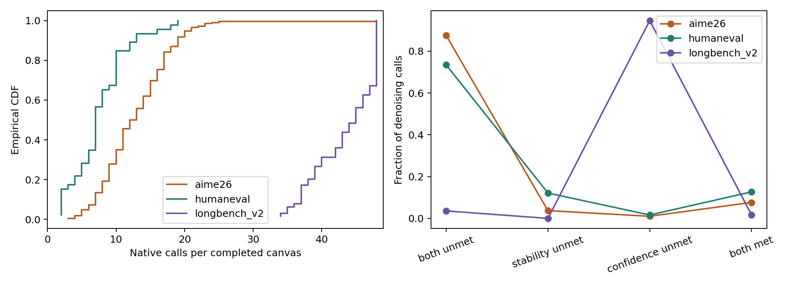
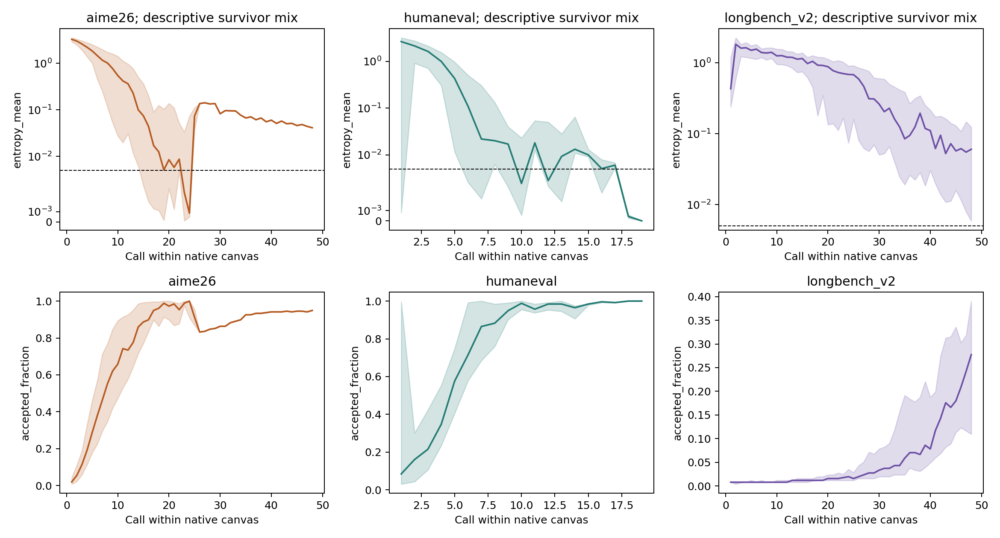
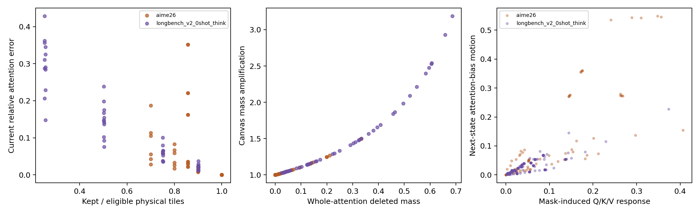

# Dense native denoising census and bounded response diagnostics

**Decision: retain the mechanism question, but do not promote a sparse selector or launch a benchmark panel from this evidence.**

Protocol `b89d910d8d16f9fbdfe5a8217142e749fef1418c68f3e2844994a805b6b121ea`. Execution is source-hash bound; spec checkpoint `11f426f1`, corrected operator checkpoint `22c7ba43`. The original 30-item identity and pre-existing frozen files are preserved.

## Dense native results

| Workload | Completed / planned | Official correct | N | Emitted C | Pooled N/C | Completed-canvas N/C | Mean output T | Cap canvases | Output caps |
|---|---:|---:|---:|---:|---:|---:|---:|---:|---:|
| aime26 | 10/10 | 6/10 | 2700 | 208 | 12.981 | 12.933 | 5264.0 | 1/208 | 4 |
| humaneval | 10/10 | 10/10 | 362 | 46 | 7.870 | 7.652 | 972.3 | 0/46 | 0 |
| longbench_v2 | 1/10 | 0/1 | 2780 | 64 | 43.438 | 43.422 | 16384.0 | 21/64 | 1 |

All requests use the unchanged native sampler, thinking on, original seed42, and original output budgets. These are dense-only descriptive observations, not a quality-preservation or sparse acceleration result. Nine frozen LongBench prompts exceed the native262144-token limit; the user explicitly kept them blocked without truncation or replacement. The single runnable LongBench prompt has185546 tokens and produces no final response before its16384-token limit.

Every request includes one trailing uncommitted denoising call. C is the emitted/committed canvas count. N includes all executed denoising calls; completed-canvas N/C excludes that tail. The raw observer summary also contains C_observed=C+1 and must not be substituted for emitted C. Per-item fields retain both denominators.

The long item has median45 and p9048 calls per completed canvas,21/64 cap terminations.2631/2780 denoising calls are stable/history-ready but confidence-limited. This establishes a difficult confidence-limited case, not evidence that sparsity would improve it. AIME has one cap canvas/208; HumanEval has none/46.

Curves pool surviving canvases at each call and show median/IQR, not paired causal trajectories. Whole-canvas labels remain passive; no token is individually committed by these labels.

## Observer qualification and accounting

The five measured HumanEval/53 smoke requests match output hash,275 output tokens,12 sampler calls,13 model executions, prompt tokenization and final CPU/CUDA RNG states. Minimal/rich/minimal active sampler state hashes agree;24 rich-observer RNG checks pass. A separate census engine reproduces that item. Dense warm/observed pairs also agree for the first AIME and long request. Across the21 census requests there are12320 observer RNG checks, zero native convergence reconstruction mismatches, zero request captures/JIT events, and model execution counters equal engine steps.

This qualifies the observer only within the tested scope. It does not implement or validate restoration of all KV caches, page tables, compiled/layout state and native continuation. Entropy acceptance masks are reconstructed from native scaled logits; exact acceptance-buffer equivalence was not directly captured. S, S/N and clean W are unavailable because all traces are instrumented. Selector overhead is zero for the dense arm. No clean speed claim follows.

| Workload | GLOBAL eligible=kept | GLOBAL skipped | LOCAL eligible=kept | LOCAL skipped |
|---|---:|---:|---:|---:|
| aime26 | 25,583,520 | 0 | 40,696,800 | 0 |
| humaneval | 900,800 | 0 | 3,938,000 | 0 |
| longbench_v2 | 1,345,388,160 | 0 | 44,480,000 | 0 |

Geometry comes from actual native prepare-attention metadata using Q128xKV64 rectangles, not measured CUDA CTA counts. First-canvas physical work was not separately instrumented. No PIECEWISE/all-kept/V31 native comparison was run in this stage; no physical sparse-work or consumer-effect claim is made.

## Preserved-state operator diagnostic

653 candidate records (635 distinct physical supports after collapsing rounded budgets) cover12 early/middle/late states, four inherited V31 trajectories, layer29, heads0/8 and four sampled rows in the first query block. Prefix support fractions0.25/0.5/0.75/0.9 share mandatory boundary/current-canvas support.48 input files are hash-verified. Requests002/004 are held out. These are inherited sparse on-policy states with same-state dense recomputation, not the new dense census state distribution. Candidate families are mass, singleton deletion, bounded swaps and deterministic position sham; they are diagnostic supports, not a deployed ResponseGuard.

| Held-out request family | Response vs next bias motion Spearman | Current error vs next bias motion | Matched-pair concordance | Pair count (correlated) |
|---|---:|---:|---:|---:|
| aime26 | 0.906 | 0.917 | 0.625 | 16 |
| longbench_v2_0shot_think | 0.869 | 0.919 | 0.710 | 981 |

Response is associated with future attention-bias motion, and matched-pair ordering is suggestive. It does not beat current error in overall held-out correlation. The two held-out requests are not a population-level replication; pairs remain correlated within requests; identical support is deduplicated within each state/budget. No downstream logits, native acceptance/stopping interventions, correction/break labels or controlled final-answer continuation were measured. A full-state replay certificate remains absent; the study cannot claim completion of the causal protocol.

The exact local differential includes moving Q,K,V. Its query-only identity is dO/dQ=scale*Cov(V,K); key and value movement are recorded separately. Renormalization max absolute identity error is4.44e-16. Current-canvas tiles are never deleted, so alpha here is whole-attention **prefix-deleted** mass and1/(1-alpha) is the amplification of retained current-canvas mass. Actual current-canvas deletion is not tested.

The norm-based prefix retained-mass certificate has no observed violation. All18 all-kept records (12 distinct after collapsing rounded budgets) have exact certificates of1. Every one of1481 partial-support checks has a bound below0.5. This conservative bound cannot justify useful refresh selectivity. No production ValidityReuse variant is implemented.

The first operator attempt is preserved with FP32 relative-error outliers and repeated candidate supports. Corrected operator_diagnostic002 uses FP64, deduplicated supports and exact all-kept certificates. All653 records pass the frozen finite-difference tolerance (absolute error <=1e-5+1e-3 times analytic norm); median relative error is8.05e-7 and maximum absolute error4.14e-5. This numerical qualification is not native transition evidence.

The fixed candidate-selection readout collapses rounded budgets to635 physical supports in84 groups. It chooses minimum response among the frozen feasible candidates, with mass fallback; current-error selection uses the same feasible set, and a support-hash sham is outcome-independent. On the held-out AIME request, response selection has0 lower /22 equal /2 higher next attention-bias-motion outcomes versus current-error selection. On held-out LongBench, it has5 lower /15 equal /4 higher. Twelve of24 LongBench groups require fallback. These are posthoc analytical readouts of the frozen bank, not native transitions or a global support oracle. The reproducible candidate_readout.py reproduces the saved JSON exactly. This mixed result does not justify a proxy or native benchmark.

## Go/no-go and unfinished work

- **dense_observer: GO within tested scope.** Output, active sampler state, RNG, prompt identity and forward counts match; zero predicate mismatches.
- **response_guard: NO_GO for native selector or proxy.** Held-out response correlation does not beat current output error on either request; matched pairs supply only attention-level descriptive evidence.
- **margin_guard: NOT_EVALUATED.** No downstream margin, acceptance, correction/break or native continuation oracle.
- **validity_reuse: NO_GO for this norm-bound implementation.** No bound violations, but every partial-support bound below 0.5; practical selectivity not established.
- **native_acceleration: UNESTABLISHED.** No matched sparse native arms, no clean timing, no full-state causal fork certificate.
- **long_context_generalization: BLOCKED COVERAGE.** Nine context-over-limit items preserved; only one LongBench request ran and it was capped/wrong.

Next engineering work is an exact native full-state snapshot/restore certificate and same-support continuation before any support intervention. After that gate, evaluate the exact ResponseGuard candidate-ranking oracle against current-error and sham controls on dense states. MarginGuard remains an untested exact-oracle track; do not build a cheap proxy yet. The tested norm certificate is a negative practical lead for ValidityReuse. No full benchmark, kernel tuning, adaptive K or accuracy-fitted rescue is justified.

Phase0 audit and the eligible dense census component of Phase1 are complete; full30 coverage is partial by explicit user instruction. Phase2 has only bounded attention-level D1/D3/D4/D5 components. Incremental D2 native headroom, logit/acceptance/self-conditioning interventions, full-state causal forks and held-out native transition prediction remain incomplete. Phase3 methods and matched native controls have not run. No novelty, accuracy preservation, trajectory acceleration or speedup is established.

## Provenance and primary sources

Yuhan owns the inherited first cross-step reuse baseline. V31, Gaussian32/value-direction routing, query-sensitivity/C-gate and V2 remain distinct prior method families. Historical value/reconstruction, refresh, consumer and timing negatives are preserved; this study does not rename or replace them.

The [DiffusionGemma report](https://arxiv.org/pdf/2608.00146) supplies the native sampler contract and warns that entropy collapse can terminate incorrect/repetitive outputs. [SparseD](https://arxiv.org/html/2509.24014v1) and [MAGE](https://arxiv.org/html/2602.14209) precede support reuse; [TABES](https://arxiv.org/html/2602.00250v2) precedes future-uncertainty steering. Retrieved primary documents and hashes are preserved in execution001/research_sources; no novelty claim follows.

## Reproducibility and limitations

See protocol.json, source_fingerprints.json, smoke/receipt.json, census_short and census_long final_complete markers, scoring001/official_scores.json, operator_diagnostic002/protocol.json and summary.json. Failed execution001/002/003 remain intact. Source/runtime hashes match; torch2.13.0+cu130, vLLM0.30.0, H10080GB, supported V2 runner and exact mask/window fixes. No paused campaign was resumed. Private prompts, gold, token IDs and raw completions remain ignored/private.

Exact experiment commands and environment overrides are in COMMANDS.md and command_receipts.json. All22 focused CPU tests pass; every one of16 pinned model files (including11 weight shards) matches its size and SHA256. CPU tests and analysis hashes are in the integrity receipt. There is no whole-study final_complete marker. The report completion marker closes only this diagnostic report.
