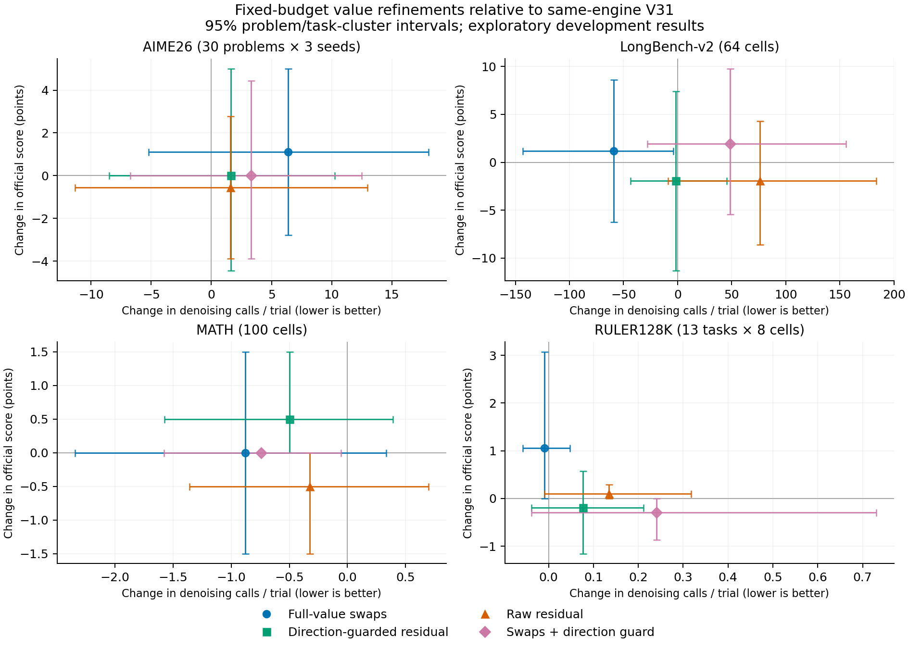

# Fixed-budget value refinements: completed replicated evaluation

Official scoring is complete for 358 input/seed cells across four workloads: 5,370 generation trials, including references. Each candidate has two trials per cell; V31 has four control bookends. This is repeated evaluation, not pass@2 or ensembling.

Value changes are confined to GLOBAL layer 29. Every query head and Q128 tile keeps the same eligible-prefix K (27 for AIME/MATH; 128 for LongBench/RULER), plus shared mandatory/carry blocks. LOCAL remains dense and native sampling is unchanged. Clean timing remains paused; audit durations and call counts are not speedup.

Inputs were previously examined development data. Intervals are separate problem/task and paired engine-shard sensitivity analyses, not simultaneous confidence regions or noninferiority guarantees. All structurally valid outcomes, including control drift, remain.

## AIME26 (30 problems × 3 seeds)

Official accuracy; calls and lengths are averages per generation trial.

| Method | Score | Calls N | N/C | Canvases C | Tokens T | p95 N | Cap % |
|---|---:|---:|---:|---:|---:|---:|---:|
| V31 control | 51.111 | 295.300 | 13.472 | 21.919 | 5543.4 | 559.05 | 42.50 |
| Full-value swaps | 52.222 | 301.672 | 13.514 | 22.322 | 5638.2 | 574.50 | 40.00 |
| Direction-guarded residual | 51.111 | 296.911 | 13.445 | 22.083 | 5580.2 | 570.50 | 42.78 |
| Raw residual | 50.556 | 296.861 | 13.518 | 21.961 | 5541.5 | 556.20 | 40.56 |
| Swaps + direction guard | 51.111 | 298.611 | 13.488 | 22.139 | 5589.6 | 565.00 | 42.22 |
| Dense FULL fix51994 | 55.556 | 298.422 | 13.402 | 22.267 | 5626.4 | 538.10 | 41.11 |
| Dense PIECEWISE | 58.889 | 281.800 | 13.161 | 21.411 | 5404.5 | 572.65 | 38.89 |
| All-kept FA4 | 58.889 | 284.222 | 13.309 | 21.356 | 5390.8 | 552.30 | 35.56 |

| Candidate | Score difference [95% interval] | N difference [95% interval] | N change % | Local screen |
|---|---:|---:|---:|---|
| Full-value swaps | +1.111 [-2.778, 5.000] | +6.372 [-5.228, 18.058] | +2.16% | Fail |
| Direction-guarded residual | +0.000 [-4.444, 5.000] | +1.611 [-8.500, 10.258] | +0.55% | Fail |
| Raw residual | -0.556 [-3.889, 2.778] | +1.561 [-11.356, 12.961] | +0.53% | Fail |
| Swaps + direction guard | +0.000 [-3.889, 4.444] | +3.311 [-6.731, 12.497] | +1.12% | Fail |

Control bookends: 13/180 output-hash differences; 0 score disagreements. First-control hashes differ across engines on 73/90 cells. Dense/all-kept references use separate engines; incremental comparisons use same-engine control pairs.

## LongBench-v2 (64 cells)

Official accuracy; calls and lengths are averages per generation trial.

| Method | Score | Calls N | N/C | Canvases C | Tokens T | p95 N | Cap % |
|---|---:|---:|---:|---:|---:|---:|---:|
| V31 control | 45.703 | 251.039 | 21.646 | 11.598 | 2835.6 | 612.00 | 1.56 |
| Full-value swaps | 46.875 | 192.023 | 18.578 | 10.336 | 2500.9 | 537.00 | 0.00 |
| Direction-guarded residual | 43.750 | 249.516 | 21.207 | 11.766 | 2884.5 | 536.00 | 1.56 |
| Raw residual | 43.750 | 327.094 | 25.781 | 12.688 | 3132.5 | 1595.00 | 4.69 |
| Swaps + direction guard | 47.656 | 299.438 | 24.320 | 12.312 | 3020.2 | 727.80 | 3.12 |
| Dense FULL fix51994 | 51.562 | 234.625 | 20.183 | 11.625 | 2848.2 | 534.10 | 1.56 |
| Dense PIECEWISE | 46.875 | 258.781 | 19.371 | 13.359 | 3293.0 | 708.35 | 3.12 |
| All-kept FA4 | 51.562 | 305.953 | 23.592 | 12.969 | 3199.4 | 835.40 | 4.69 |

| Candidate | Score difference [95% interval] | N difference [95% interval] | N change % | Local screen |
|---|---:|---:|---:|---|
| Full-value swaps | +1.172 [-6.250, 8.594] | -59.016 [-143.250, -3.988] | -23.51% | Pass |
| Direction-guarded residual | -1.953 [-11.328, 7.422] | -1.523 [-43.344, 45.194] | -0.61% | Fail |
| Raw residual | -1.953 [-8.594, 4.297] | +76.055 [-8.907, 183.821] | +30.30% | Fail |
| Swaps + direction guard | +1.953 [-5.469, 9.766] | +48.398 [-28.086, 155.603] | +19.28% | Fail |

Control bookends: 6/128 output-hash differences; 1 score disagreements. First-control hashes differ across engines on 4/64 cells. Dense/all-kept references use separate engines; incremental comparisons use same-engine control pairs.

## MATH (100 cells)

Official accuracy; calls and lengths are averages per generation trial.

| Method | Score | Calls N | N/C | Canvases C | Tokens T | p95 N | Cap % |
|---|---:|---:|---:|---:|---:|---:|---:|
| V31 control | 95.000 | 61.468 | 9.874 | 6.225 | 1474.9 | 161.00 | 4.00 |
| Full-value swaps | 95.000 | 60.590 | 9.765 | 6.205 | 1469.7 | 145.20 | 4.00 |
| Direction-guarded residual | 95.500 | 60.970 | 9.834 | 6.200 | 1470.9 | 167.05 | 3.50 |
| Raw residual | 94.500 | 61.145 | 9.862 | 6.200 | 1470.5 | 155.45 | 4.50 |
| Swaps + direction guard | 95.000 | 60.725 | 9.779 | 6.210 | 1474.1 | 152.50 | 4.00 |
| Dense FULL fix51994 | 95.000 | 61.370 | 9.882 | 6.210 | 1468.8 | 174.55 | 5.00 |
| Dense PIECEWISE | 95.000 | 63.020 | 9.940 | 6.340 | 1502.5 | 192.40 | 5.00 |
| All-kept FA4 | 95.000 | 58.560 | 9.569 | 6.120 | 1442.1 | 121.15 | 3.00 |

| Candidate | Score difference [95% interval] | N difference [95% interval] | N change % | Local screen |
|---|---:|---:|---:|---|
| Full-value swaps | +0.000 [-1.500, 1.500] | -0.877 [-2.345, 0.335] | -1.43% | Pass |
| Direction-guarded residual | +0.500 [0.000, 1.500] | -0.497 [-1.575, 0.393] | -0.81% | Pass |
| Raw residual | -0.500 [-1.500, 0.000] | -0.323 [-1.357, 0.698] | -0.52% | Fail |
| Swaps + direction guard | +0.000 [0.000, 0.000] | -0.743 [-1.577, -0.058] | -1.21% | Pass |

Control bookends: 1/200 output-hash differences; 0 score disagreements. First-control hashes differ across engines on 100/100 cells. Dense/all-kept references use separate engines; incremental comparisons use same-engine control pairs.

## RULER128K (13 tasks × 8 cells)

RULER uses the official task-average 0–100 score; other scores are accuracy percentages.

| Method | Score | Calls N | N/C | Canvases C | Tokens T | p95 N | Cap % |
|---|---:|---:|---:|---:|---:|---:|---:|
| V31 control | 86.250 | 5.240 | 5.240 | 1.000 | 26.0 | 11.00 | 0.96 |
| Full-value swaps | 87.308 | 5.231 | 5.231 | 1.000 | 26.0 | 10.00 | 0.96 |
| Direction-guarded residual | 86.058 | 5.317 | 5.317 | 1.000 | 25.9 | 10.00 | 0.96 |
| Raw residual | 86.346 | 5.375 | 5.375 | 1.000 | 25.9 | 11.00 | 0.96 |
| Swaps + direction guard | 85.962 | 5.481 | 5.481 | 1.000 | 26.0 | 11.00 | 1.92 |
| Dense FULL fix51994 | 86.538 | 5.750 | 5.750 | 1.000 | 25.8 | 10.00 | 0.96 |
| Dense PIECEWISE | 86.538 | 5.654 | 5.654 | 1.000 | 25.7 | 10.00 | 0.96 |
| All-kept FA4 | 84.856 | 5.558 | 5.558 | 1.000 | 25.7 | 12.00 | 1.92 |

| Candidate | Score difference [95% interval] | N difference [95% interval] | N change % | Local screen |
|---|---:|---:|---:|---|
| Full-value swaps | +1.058 [0.000, 3.077] | -0.010 [-0.058, 0.048] | -0.18% | Pass |
| Direction-guarded residual | -0.192 [-1.154, 0.577] | +0.077 [-0.038, 0.212] | +1.47% | Fail |
| Raw residual | +0.096 [0.000, 0.288] | +0.135 [-0.010, 0.317] | +2.57% | Fail |
| Swaps + direction guard | -0.288 [-0.865, 0.000] | +0.240 [-0.038, 0.731] | +4.59% | Fail |

Control bookends: 0/208 output-hash differences; 0 score disagreements. First-control hashes differ across engines on 0/104 cells. Dense/all-kept references use separate engines; incremental comparisons use same-engine control pairs.

## Promotion and work accounting

Full503 candidates under the predeclared all-workload screen: `[]`. No further accuracy panel or timing run is launched by this report.

`results.csv` contains per-trial GLOBAL, LOCAL and overall physical work, extra full-QK/PV discovery and correction-path counts. The overall denominator is decode GLOBAL full-support plus LOCAL window-intersecting H × Q128 × KV64 rectangles. Correction-path calls do not imply a nonzero correction on every row. Warmup requests are excluded from measured trials; the initial dense phases within measured requests remain in their accounting.

`comparisons.csv` includes both problem/task and engine-block intervals. Per-workload JSON reports retain phase accounting, repeat-specific contrasts and all control drift. Paired trajectory diagnostics give C-versus-N/C decomposition and outcome-conditioned groups; those groups and tail trimming are descriptive, selection-biased analyses rather than causal effects.
